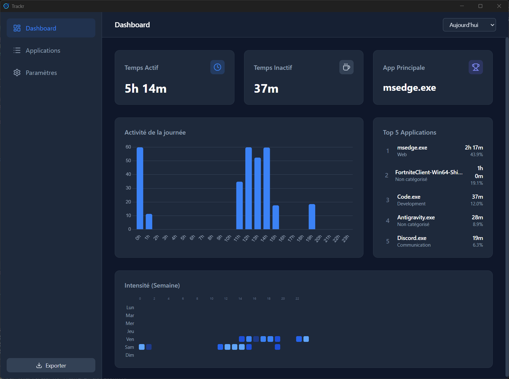

<div align="center">
  <h1>Trackr</h1>
  <p>Une application Windows de tracking de temps d'écran 100% hors-ligne, élégante et ultra-légère.</p>
</div>



Trackr est votre compagnon de productivité. Il tourne discrètement en arrière-plan, analyse vos habitudes sur Windows et vous restitue des statistiques détaillées pour mieux comprendre où passe votre temps, tout cela en garantissant une confidentialité totale de vos données.

## ✨ Fonctionnalités

- 📊 **Tableau de bord intelligent** : Visualisez instantanément votre temps actif, inactif et l'application la plus utilisée de la journée.
- 📈 **Analyses & Graphiques (Chart.js)** : 
  - **Activité de la journée** : Frise chronologique heure par heure pour repérer vos pics de concentration.
  - **Top 5 Applications** : Classement détaillé de vos logiciels les plus chronophages avec leur durée exacte et pourcentage.
  - **Intensité (Semaine)** : Heatmap type "GitHub" montrant vos heures d'activité les plus intenses.
- 🕵️ **100% Hors-Ligne & Léger** : Aucune donnée ne quitte votre PC. Tout est stocké dans une base SQLite locale. La détection d'activité utilise l'API native Windows (`GetLastInputInfo`) pour un impact nul sur le CPU.
- ⚙️ **Configuration Flexible** :
  - Lancement automatique et silencieux (System Tray) avec Windows.
  - Intervalles d'actualisation ajustables.
  - Détection du mode plein écran (pour les jeux/films) et de l'inactivité désactivables.
  - Système de catégorisation d'applications entièrement personnalisable.
- 📉 **Export des données** : Exportez facilement vos logs complets au format CSV.
- 🎨 **Interface Moderne** : UI épurée développée avec PyWebView et TailwindCSS (Dark Mode).

## 🚀 Installation & Compilation

Si vous souhaitez modifier le code ou compiler vous-même l'application :

### Prérequis
- Python 3.10 ou supérieur
- Windows

### Instructions

1. Clonez ce dépôt.
2. Activez un environnement virtuel et installez les dépendances :
   ```powershell
   python -m venv .venv
   .\.venv\Scripts\Activate.ps1
   pip install -r requirements.txt
   ```
3. Lancez l'application en mode développement :
   ```powershell
   python run.py
   ```
4. **Compilez l'exécutable final (.exe)** :
   ```powershell
   python build.py
   ```
   *Un exécutable standalone (Trackr.exe) sera généré dans le dossier `dist/`.*

## 🛠️ Stack Technique

- **Backend** : Python, SQLite3, `pywin32` (WinAPI), `psutil`, `pystray`.
- **Frontend** : PyWebView, HTML/Vanilla JS, Tailwind CSS, Chart.js, Lucide Icons.
- **Build** : PyInstaller.

---
*Analysez. Comprenez. Optimisez votre temps.*
